# Process log

How I built TrainBoard with AI. Each entry is a real moment from the build: what I asked for, what the AI came back with, and what I decided. Where I disagreed with it, the entry says so.

Tools: Claude Code (Opus) in the terminal for code, API checks and repo setup.

## The problem

Two things kept annoying me.

**Meeting a friend off a train.** To see when a friend's train gets to my local station, I have to open Trainline, work out the route they've taken and which train they got on, then go through the arrival times stop by stop to find when it reaches my station. It's guesswork.

**Station screens only show the next two trains.** I often work on my laptop at a station or in a coffee shop nearby, where there's no departure screen at all, and the screens that do exist only show the next two trains. I want to see the next five, and know straight away if anything changes.

I'd already had a departure widget on my desktop for a while. It works, but it doesn't solve either of these, so I rebuilt it from scratch around them.

## Log

### 1. Picking the lens
- **Asked:** read the brief and suggest projects.
- **AI:** suggested a few options from my own work, mostly data-heavy "make it click" ideas.
- **Decided:** I went with Lens A, a working tool, because this is a daily annoyance I actually have.

### 2. Rebuild, not reuse
- **AI:** suggested renaming and archiving the old widget's repo and keeping it public.
- **Pushed back:** I wanted a clean start, so I made the old repo private and started fresh. Every line in this repo is written for this build.

### 3. Time limit
- **AI:** suggested starting a strict 3 hour clock at the first line of code.
- **Pushed back:** I kept it loose and put the time into getting the experience right.

### 4. Checking train tracking is possible
- **Asked:** can the board find the train a friend is on, like the 12:50 London to Fratton?
- **AI:** tested the traini.ac API live. The journey lookup (`/v1/journey/WAT/FTN`) returns a train id for each service, and the same id can be matched on the Fratton board, so the widget can highlight that train.
- **Decided:** build around that match.

### 5. Rebuilding the board
- **Asked:** rebuild the old widget almost one for one, then add train tracking. Design comes later.
- **AI:** wrote a new Swift app and widget on the traini.ac API: a departure board in three sizes, a station picker per widget, and a form in the app to track a train.

### 6. The first build showed no trains
- **AI:** every board said "No trains available". It traced this to trains that have no live id until they start running, so it switched to the timetable id, which every train has. That also fixed tracking a train hours before it leaves, since that train has no live id yet either.

### 7. Questioning the scope
- **AI:** had added a hidden mode to the app that saved pictures of the widget, so it could check layouts.
- **Pushed back:** I stopped it and told it to question every part of the request before building. It moved that check into the test suite instead, and dropped the other countries the old widget had.

### 8. A train, not a friend
- **AI:** had built "friend's train" tracking, with a name field.
- **Pushed back:** the use case is meeting a friend, but what you track is a train. Renamed it to tracking a train and dropped the name.

### 9. Clean code, UK only
- **Asked:** make the code really clear, use the traini.ac API, and stick to what it covers.
- **AI:** split the code into small files (API client, tracked train, board data, board view, widget, app), and added six tests that run on saved API answers and render every widget size to check the layout.
- **AI:** spotted in the renders that a late train sat below later ones, because the API orders by expected time. Station screens order by the timetable, so the board now does too.

### 10. "This is horrific UI"
- **Pushed back:** I marked up the first app window and said it wasn't intuitive. I wanted a proper place to search a From station and a To station, and to pick a time rather than type one. I asked it to use Apple's built-in controls and write as little code as possible.
- **AI:** rebuilt the window as a standard macOS settings-style form. Both stations are search fields that suggest stations as you type, and the time became a picker.

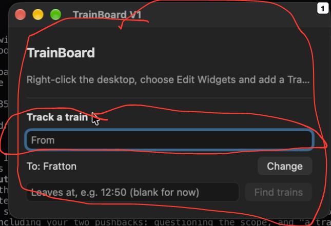
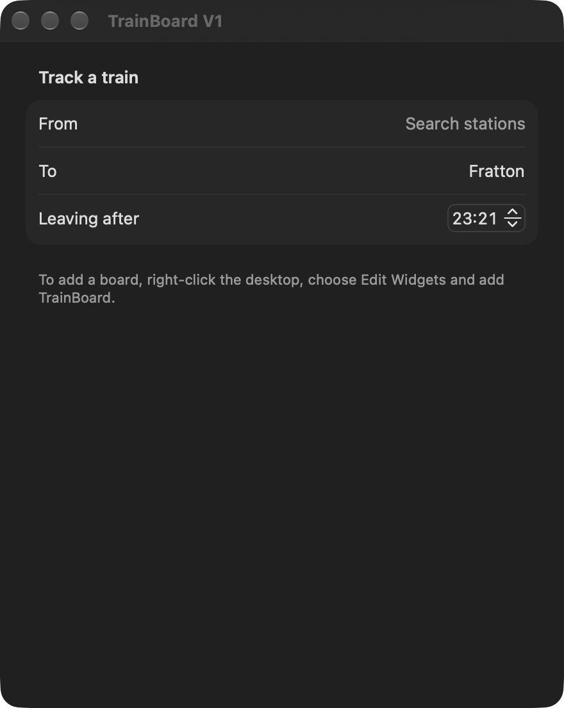
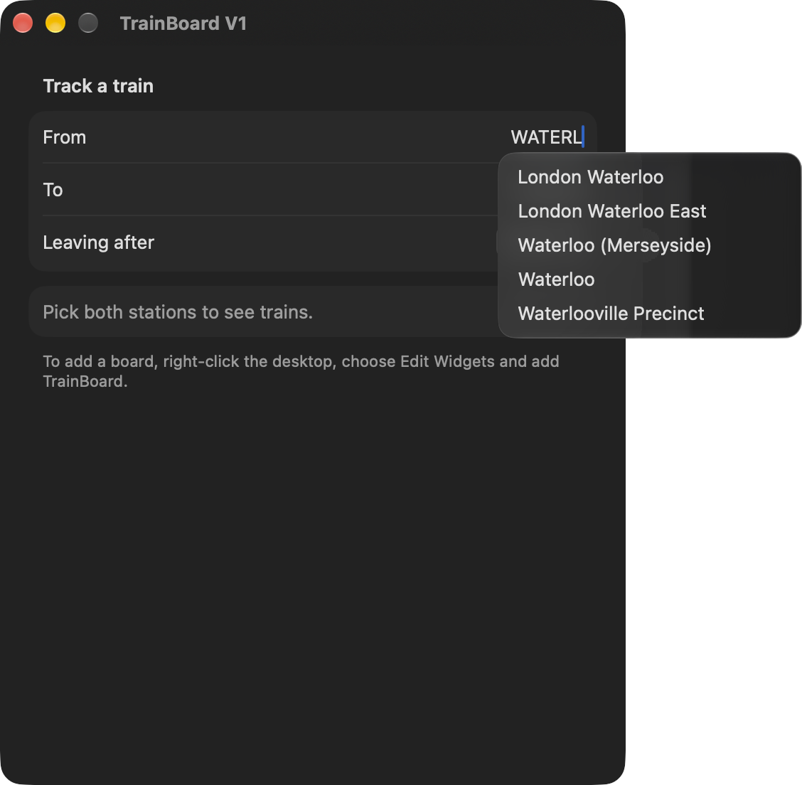

### 11. No date picker, for now
- **Asked:** add a date picker as well.
- **AI pushed back:** it tested the API first and found journey searches only cover today (it ignored the date it was sent). A date picker would offer days the app can't search, so it left the date out and noted it in the code as a known limit.
- **Decided:** time only until the API takes a date.

### 12. Leave after or arrive by
- **Pushed back:** the time control looked ugly, there was a big empty gap under the form, and I wanted to choose between leaving after a time and arriving by one, as a pill switch.
- **AI:** added a Leave after / Arrive by switch, swapped the time field for a menu of times left today, and sized the window to fit the form. The API only filters on departure time, so "arrive by" searches the three hours before and keeps the trains that get in on time.
- **AI:** while testing, it found that typing a station's full name didn't count as picking it, and fixed that.
- **Pushed back:** a scroll bar was still showing on a window with nothing to scroll. It's gone.

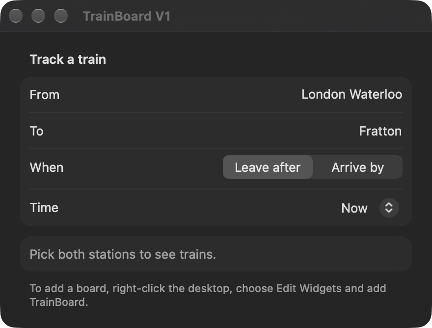
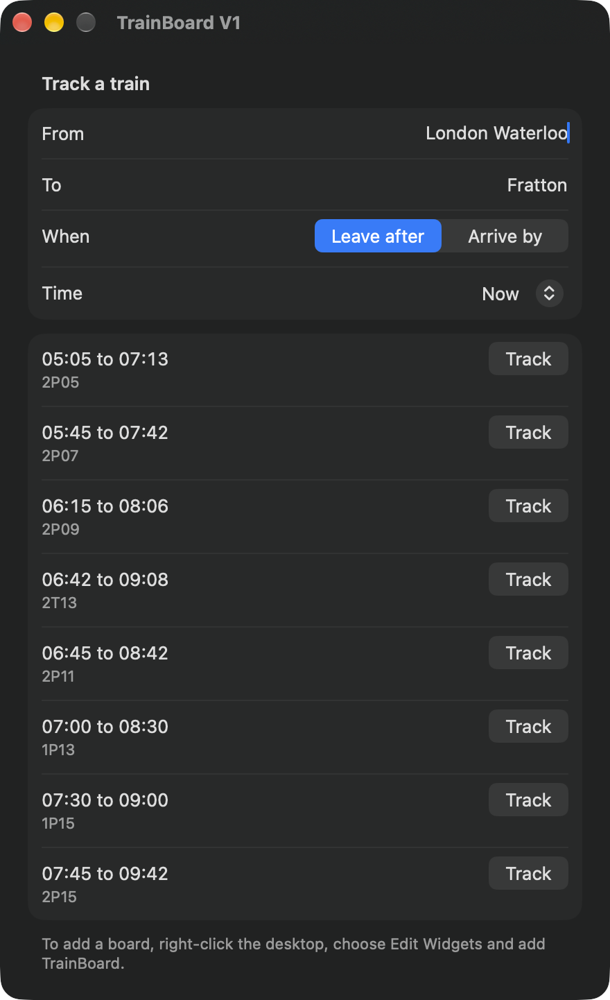

### 13. Glass, and room to breathe
- **Pushed back:** on my desktop the board felt cramped, with the station name and clock jammed into the corners. I liked how it looked in macOS's glass mode (when a window is in front), but in full colour the amber board didn't sit well next to Apple's widgets. I wanted a choice of looks.
- **AI:** added padding, cut the medium board to five rows, and gave each widget a Style option, Glass or Station board. Both work with the system's own glass and tinted modes, with the tracked train picked out in the accent colour.

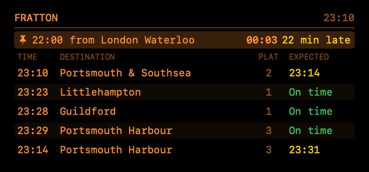
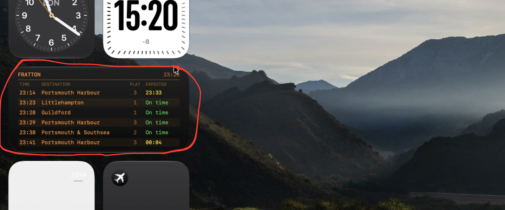
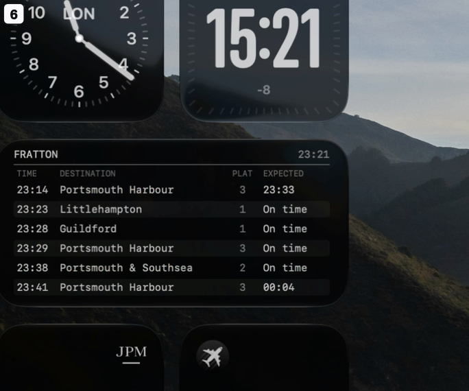
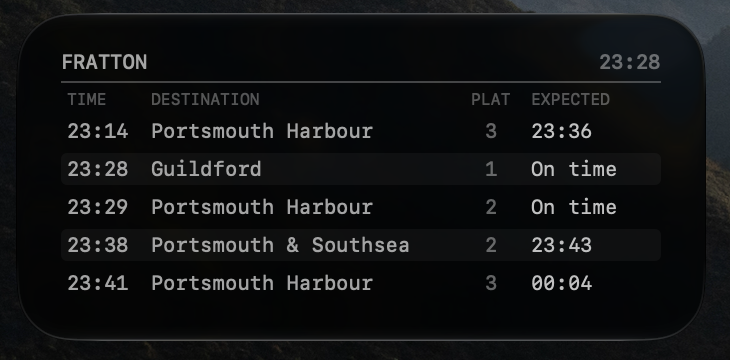

### 14. A cramped banner
- **Pushed back:** on the desktop, the tracked train's arrival time and "min late" were jammed together.
- **AI:** gave the banner more room, and found the real cause while looking: with a train tracked, the board was taller than the widget, so the banner was sliding over the column titles. Rows that don't fit are now cut off at the bottom instead.

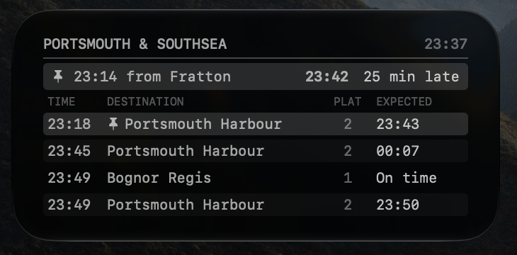

### 15. 12 or 24 hour
- **Asked:** let people choose a 12 or 24 hour clock.
- **AI pushed back:** macOS already has that switch (System Settings, General, Date and Time), so rather than adding a second one, every time on the board and in the app now follows the Mac's setting. Times sent to the API stay 24 hour whatever the Mac shows.

### 16. When the train gets in
- **Asked:** what happens when the train arrives? I wanted it to stay for two minutes at most, then go.
- **AI:** before, the arrival banner stayed until an hour after the scheduled arrival. Now it leaves the board two minutes after the train actually gets in, or two minutes after it's expected if there's no live arrival. The saved train still clears itself after three hours, for trains so late the board never sees them arrive.

### 17. Wider rows, and the app lets go too
- **Pushed back:** the rows were too tight to the sides; there was too much padding.
- **AI:** turned off the system's widget margins and set narrower ones, so rows run nearly edge to edge. It also measured the real widget size from my desktop captures, so the test renders now match what's on screen.
- **Asked:** the app should stop tracking after the train arrives too, not just the widget.
- **AI:** the app now checks the train every minute while it's open, and stops tracking once the board has let it go.

### 18. No style option, track from the widget
- **Pushed back:** I'd only wanted to check a style choice was possible. macOS already lets people pick full colour, glass or tinted widgets in System Settings, so the widget doesn't need its own Style option. The Edit panel should just be the station.
- **AI:** removed the Style option and the amber station-board look, so the board uses system colours and macOS applies its own looks on top.
- **Asked:** people should be able to track a train by right-clicking the widget.
- **AI:** right-click, Edit "TrainBoard" now has "Track a train from" and "Train" under Station. Pick where the train is coming from and it lists today's direct trains to the widget's station. A train picked there beats one tracked from the app. It kept the macOS menu wording, since that comes from the system.

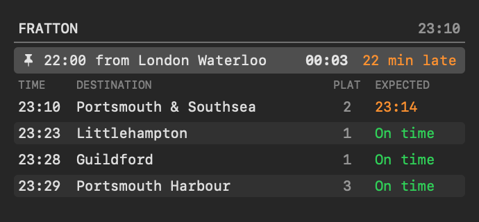

### 19. A small widget that fits
- **Pushed back:** the small widget was "horrifically messy": long destination names cut off, and no platform or expected time. Every UK station has a three-letter code, so I asked for those in the small size.
- **AI:** the small widget now shows time, station code, platform and expected time on every row, and the tracked train banner reads "from WAT" with its arrival time coloured by status.

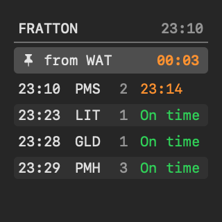

### 20. Filling the widget
- **Pushed back:** there was a big empty gap at the bottom of the widget.
- **AI:** the gap came from each size showing a fixed number of rows. It replaced the fixed counts with a small layout that shows as many whole rows as fit, so every size fills up without cutting a row in half. The row counts are gone from the code.

- **Pushed back:** the station name and clock still sat too close to the widget's rounded top corners. They're now set further in than the rows.

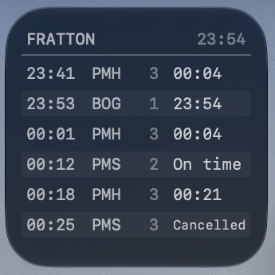
