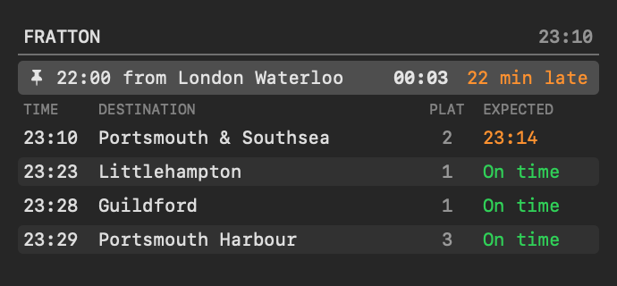

# TrainBoard

A live train departure board for the macOS desktop, built as a WidgetKit widget.

Track a train (say the 12:50 from London Waterloo that a friend is on) and your home station's board pins its arrival time at the top and picks it out in the list, so you know when it gets in without opening an app.

UK trains, with data from the [traini.ac API](https://traini.ac/developers). Built with Claude Code and other AI dev tools; see [how this was built](#how-this-was-built).



## Download

**[Download TrainBoard for Mac](https://github.com/Joseph2475/trainboard-v1/releases/latest/download/TrainBoard.zip)** (macOS 15 or later)

1. Open the download and drag **TrainBoard V1** into Applications.
2. Open it once. This is also where you track a train.
3. Right-click the desktop, choose **Edit Widgets** and add **TrainBoard**. Right-click the widget and choose **Edit** to pick its station. Click the widget to open the app and track a train.

To update, download it again and replace the app in Applications.

## Releasing an update

```sh
scripts/release.sh 1.1
```

Builds, signs and notarizes the app and publishes it as a GitHub release, which the Download link above always points to. Needs the Developer ID certificate and the `trainboard` notary profile in this Mac's keychain.

## Build from source

Needs Xcode and [XcodeGen](https://github.com/yonaskolb/XcodeGen).

```sh
xcodegen generate
xcodebuild -project TrainBoardV1.xcodeproj -scheme TrainBoardV1 -configuration Release -derivedDataPath build build
```

## Tests

```sh
xcodebuild -project TrainBoardV1.xcodeproj -scheme TrainBoardV1 -derivedDataPath build build-for-testing
xcrun xctest build/Build/Products/Debug/TrainBoardV1Tests.xctest
```

The tests run on saved API answers in `Tests/Fixtures`, and save a picture of every widget size to a `trainboard-renders` folder in the temp directory.

## Code

| File | What it does |
|---|---|
| `Shared/Trainiac.swift` | The API client and the shapes it returns |
| `Shared/TrackedTrain.swift` | The train being tracked, shared between app and widget |
| `Shared/BoardEntry.swift` | What one board shows at one moment |
| `Shared/BoardView.swift` | The board itself |
| `Widget/TrainBoardWidget.swift` | The widget, its timeline and station picker |
| `App/TrainBoardApp.swift` | The app window, where you pick a train to track |
| `scripts/release.sh` | Publishes a signed, notarized release for the Download link |

## How this was built

I built TrainBoard with Claude Code and other AI dev tools. The AI wrote and tested the code; I made the product and design calls, and pushed back when it got them wrong.

- **Feedback by drawing on the screen.** Instead of describing problems in text, I recorded my screen, circled what was wrong and talked through it. The AI read those recordings and made the changes.
- **Pushback both ways.** I rejected its first app window ("horrific UI"), its "friend's train" framing, a widget style option and a cramped small widget. It pushed back on me too: it tested the train API before adding a date picker, found it only searches today's trains, and talked me out of it.
- **Testing as it went.** It caught bugs I hadn't seen, like trains that aren't running yet having no live ID, which left the board empty. Tests run on saved train data and draw every widget size, so layout changes can be checked as pictures.
- **Every step logged.** [PROCESS.md](PROCESS.md) records each step: what I asked for, what the AI did, and who changed course. [docs/versions](docs/versions) has a screenshot of each version along the way.
